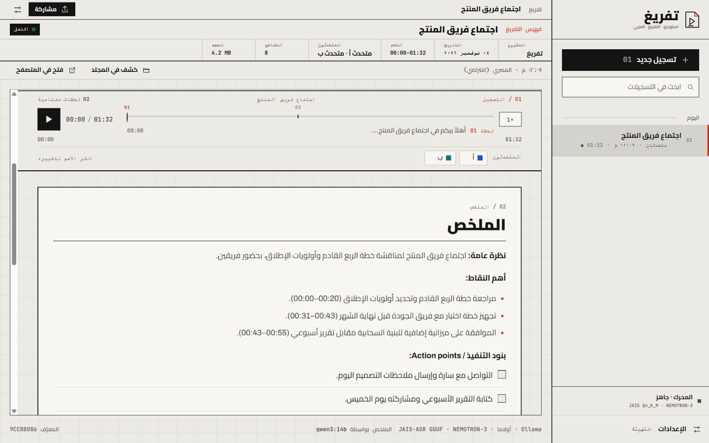
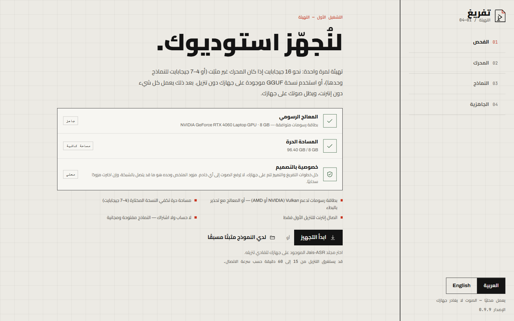
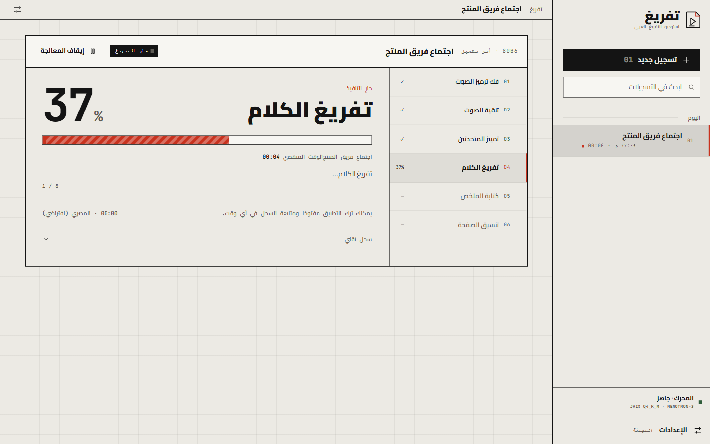
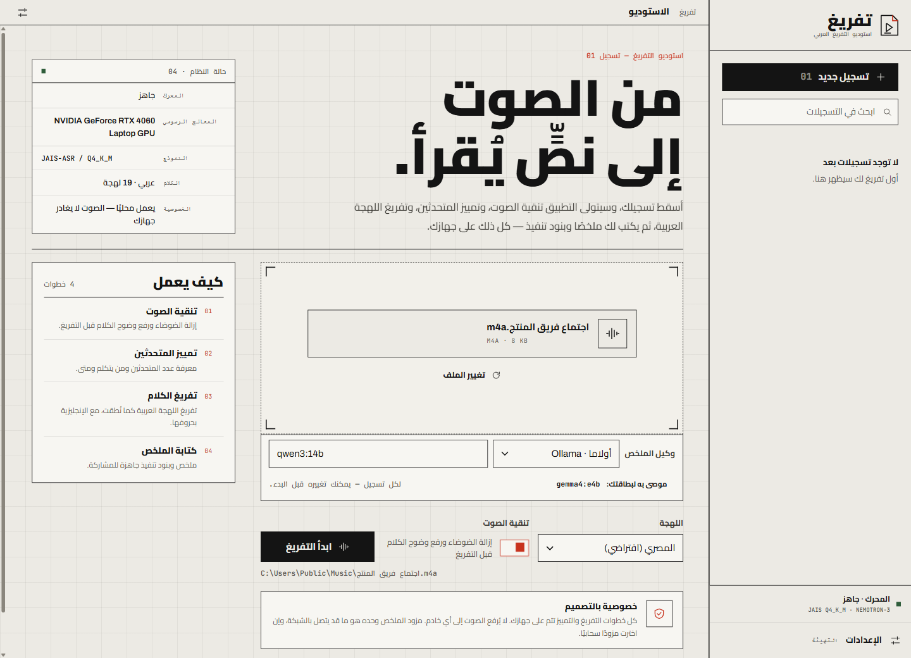
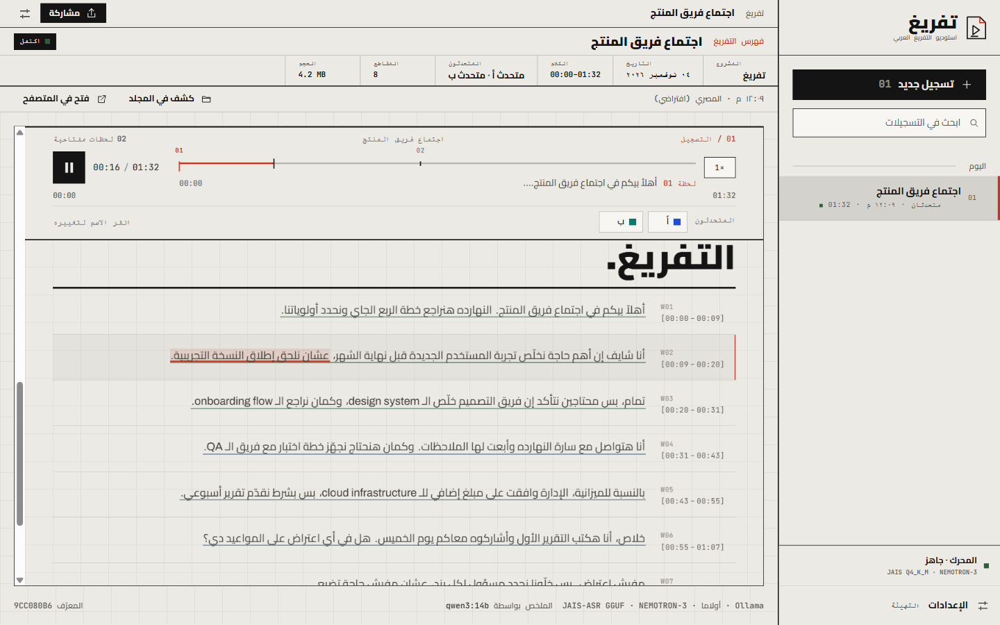
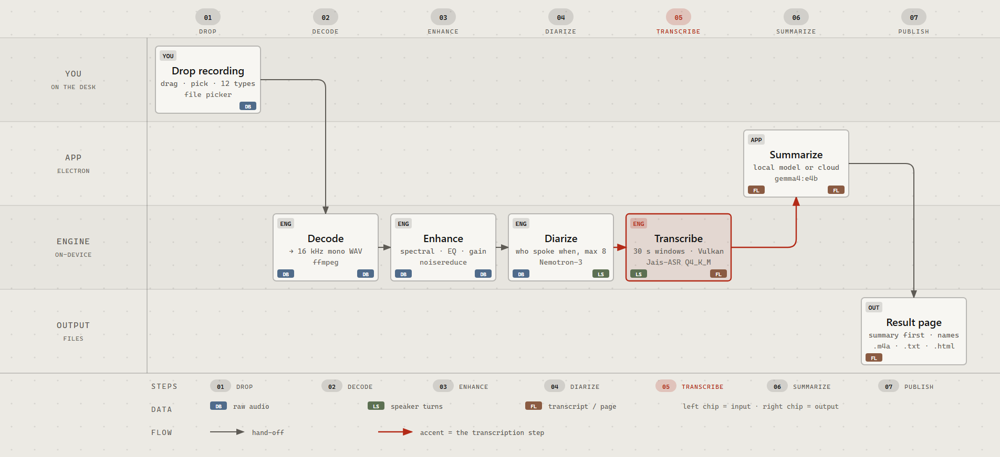

# تفريغ — Tafreegh

[English](README.md) · **العربية**

«تفريغ» تطبيق سطح مكتب لنظام Windows يحوّل التسجيلات العربية إلى نصّ مع تمييز المتحدثين، ويضيف إليه ملخّصًا، ثم ينشر النتيجة في صفحة HTML واحدة مكتفية بذاتها. بُني بـElectron 45 وReact 19 وTypeScript، مع محرّك Python 3.12 يعالج الصوت. ليس تطبيق ويب: لا Docker، ولا خادم محلي، ولا حاجة إلى متصفح، لأن النتيجة تُعرض داخل التطبيق في إطار معزول. يُوزَّع بمثبِّتَيْن لإصدار x64، ملف MSI وملف NSIS EXE، الإصدار 0.9.9. المثبِّت غير موقَّع رقميًا، فيُظهر SmartScreen تحذيرًا عند أول تشغيل.

## الدقة والاستخدام

> **«تفريغ» أداة مساعدة، وليس سجلًا يُحتجّ به.**

النص وأسماء المتحدثين ينتجهما نموذج آلي، وستقع فيهما أخطاء: كلمات مسموعة على غير وجهها أو ساقطة، وجُمل منسوبة إلى متحدث غير صحيح، وتوقيتات تقريبية، وملخص قد يحذف ما قيل أو يحرفه. تعامل مع الناتج كمسودة أولى تساعدك على التنقل في التسجيل، لا كنص حرفي موثَّق.

لا تعتمد عليه سجلًا ملزمًا قانونًا، ولا دليلًا في إجراءات قانونية أو تأديبية أو عمالية أو رسمية، ولا بديلًا عن رأي مختص. وفي هذه الحالات راجع كل مقطع على الصوت الأصلي، ودع مختصًا يراجع النتيجة.

البرنامج مقدَّم «كما هو» دون أي ضمان. وأنت مسؤول عن طريقة استخدامك للناتج.

## محلي بالكامل افتراضيًا

مسار الصوت كله يجري على جهازك. فك الترميز والتنقية وتمييز المتحدثين والتفريغ تُنفَّذ محليًا، ولا يُرفع التسجيل إلى أي جهة. لا حساب، ولا تسجيل دخول، ولا telemetry، ولا إرسال إحصاءات استخدام. وبعد التنزيل الأول يعمل التطبيق دون إنترنت تمامًا.

الاستثناء الوحيد اختياري: الملخِّص. إذا اخترت مزوّدًا سحابيًا فلا يُرسل سوى نصّ التفريغ، ولا يُرسل الصوت ولا الملف نفسه. وإذا اخترت نقطة نهاية محلية (Ollama أو LM Studio أو llama.cpp أو vLLM أو أي خادم متوافق مع OpenAI)، أو اخترت «بدون ملخص»، بقي كل شيء على الجهاز. والافتراضي محلي: Ollama على الجهاز نفسه.

## لقطات



| التهيئة | المعالجة |
|---|---|
|  |  |





كل اللقطات من وضع الاختبار `TAFREEGH_MOCK=1` بأسماء وتسجيلات وهمية. لا يحتوي هذا المستودع أي تسجيل حقيقي.

## سير العمل



المخطط مولَّد من `docs/diagram-workflow.html`، وهو ملف واحد مكتفٍ بذاته.

| # | الخطوة | ما يحدث |
|---|---|---|
| 1 | الإفلات وفك الترميز | تسحب ملفًا أو تختاره، ويفكّه ffmpeg إلى WAV أحادي بتردد 16 kHz |
| 2 | التنقية | تنقية طيفية ومعادل نطاق كلام وضغط ورفع مستوى، ويُكتب الناتج بصيغة `.m4a` |
| 3 | تمييز المتحدثين | Nemotron-3 يفصل المتحدثين على المعالج، حتى 8 متحدثين |
| 4 | التفريغ | Jais-ASR يقرأ مقاطع كلام بطول 30 ثانية عبر llama.cpp المضمّن |
| 5 | الملخص | مزوّد محلي أو سحابي يكتب نظرة عامة وأهم النقاط وبنود التنفيذ |
| 6 | تنسيق الصفحة | ملف HTML واحد فيه الصوت مضمّنًا والملخص فوق التفريغ |
| 7 | المشاركة | ثلاثة تنزيلات فقط: `.m4a` المحسّن، و`.txt`، و`.html` الكامل |

## المزايا

### الواجهة

- واجهة عربية أولًا باتجاه RTL، مع زر تبديل إلى الإنجليزية.
- تصميم «ورقة الرسم»: ورق دافئ، وشبكة ظاهرة، وخطّا Cairo وArchivo، على شبكة بمقاس 40px.

### الإدخال

- إفلات بالسحب أو اختيار من مستعرض الملفات.
- يقبل M4A وMP3 وWAV وOGG وOPUS وMP4 وAAC وFLAC وWMA وWEBM وMOV وMKV.
- 19 لهجة عربية والمصرية هي الافتراضية، إضافة إلى الكشف التلقائي والفصحى والعربية المختلطة بالإنجليزية والإنجليزية والفرنسية.

### تنقية الصوت

- تنقية طيفية عبر `noisereduce`، مع معادل نطاق الكلام وضاغط ورفع مستوى.
- غير عصبية ولا تحتاج PyTorch في مسار الصوت.
- ملف `.m4a` المحسّن أحد التنزيلات الثلاثة.

### تمييز المتحدثين

- NVIDIA Nemotron-3-Diarization، حتى 8 متحدثين.
- يعمل على المعالج (CPU).

### التفريغ

- Jais-ASR بصيغة GGUF عبر llama.cpp المضمّن.
- مقاطع كلام بطول 30 ثانية.
- الكلمات الأجنبية تبقى بحروف لاتينية ولا تُنقل إلى العربية.

### المتحدثون

- شريط المتحدثين مثبَّت أسفل المشغّل: انقر الشريحة واكتب الاسم، ثم Enter للحفظ أو Esc للإلغاء.
- ثمانية ألوان عالية التباين.
- الأسماء تُكتب في `meta.json` وفي `transcript.html` نفسه، فتبقى بعد إعادة الملخص وبعد التصدير وبعد «فتح في المتصفح».
- الأسماء الطويلة تُقصّ ويظهر الاسم كاملًا عند المرور عليه، والشريط يلتفّ بدل أن يتجاوز حدّه.
- الشريط يعمل بلوحة المفاتيح.

### الملخص

- Ollama المحلي هو الافتراضي بنموذج `gemma4:e4b`. يشغّل التطبيق `ollama serve` عند الحاجة، وينزّل النموذج مع عرض نسبة التنزيل، ويستخدم نافذة سياق 8192 رمزًا، ثم يُفرغ النموذج من الذاكرة بعد الانتهاء.
- محليًا أيضًا: LM Studio وllama.cpp وvLLM وأي نقطة نهاية متوافقة مع OpenAI.
- سحابيًا: OpenAI وAnthropic وGoogle Gemini وGroq وMistral وDeepSeek وQwen وMoonshot (Kimi) وZhipu (GLM) وOpenRouter وxAI وTogether وFireworks وOllama Cloud.
- «بدون ملخص» خيار مستقل، ويمكن إعادة الملخص لاحقًا إذا فشل أو تُرك دون إعادة معالجة الصوت.

### النتيجة

- ملف HTML واحد مكتفٍ بذاته والصوت مضمّن فيه.
- بطاقة الملخص قبل التفريغ، والتفريغ ينقلك إلى الموضع عند النقر، وإلى جانبه شريط أهم اللحظات.
- ثلاثة تنزيلات فقط: `.m4a` المحسّن، و`.txt`، و`.html` الكامل.

### السجل والتقدّم والتهيئة

- سجل جانبي فيه بحث، مجمَّع في اليوم والأمس وهذا الأسبوع وأقدم، وحذف للتسجيل مع ملفاته.
- شاشة التقدّم: قائمة المراحل والنسبة وعدّاد المقاطع والساعة والسجل التقني وزر الإلغاء.
- معالج التهيئة: فحص الكرت والمساحة، ثم المحرّك (uv وPython 3.12 والمكتبات)، ثم النماذج، ثم الجاهزية. التنزيلات تُستأنف إن انقطعت، ويمكن ربط التطبيق بمجلدات نماذج موجودة عندك، وتبديل نسخة النموذج.
- مفاتيح API مشفّرة عبر `safeStorage` في نظام التشغيل. ولا telemetry.

## النماذج والأرقام المنشورة

الأرقام التالية من قياسات الناشرين أنفسهم، ولم يقسها Tafreegh.

### التفريغ: Jais-ASR من IFM / MBZUAI

المصدر: [IFM/Jais-ASR-GGUF](https://huggingface.co/IFM/Jais-ASR-GGUF). النتائج نسب WER وCER مأخوذة بالمتوسط على مجموعات الاختبار الست في Open Universal Arabic ASR Leaderboard (SADA وCommon Voice 18 وMASC clean وMASC noisy وMGB-2 وCasablanca)، بفك ترميز greedy. الأقل أفضل.

| النسخة | التنزيل | WER % | CER % | ذروة كرت الرسوميات |
|---|---|---|---|---|
| BF16 المرجعية (غير مضمّنة) | 11.44 GB | 22.85 | 8.37 | 12.42 GiB |
| Q4_K_M مع mmproj Q6_K (الافتراضية، أقل من 9 GB) | 3.71 GB | 22.99 | 8.38 | 5.03 GiB |
| Q8_0 مع mmproj F16 (9-12.5 GB) | 6.71 GB | 22.83 | 8.35 | 7.55 GiB |

وفي ذلك التصنيف يتقدّم نموذج BF16 على النماذج المفتوحة الأخرى، وعلى واجهتي Speechmatics Melia 1 (23.51) وElevenLabs Scribe v2 (24.54) التجاريتين، في متوسط WER. ونسخة 8-bit تعادل دقة BF16 باستهلاك أقل بنحو 39% من ذاكرة كرت الرسوميات.

### تمييز المتحدثين: NVIDIA Nemotron-3-Diarization

المصدر: [nvidia/Nemotron-3-Diarization](https://huggingface.co/nvidia/Nemotron-3-Diarization). النموذج بـ100M معامل وحتى 8 متحدثين. النسب هي Diarization Error Rate (DER) بالمئة، والأقل أفضل، بإعداد 30.4 ثانية دون اتصال وبهامش 0 ثانية، عدا CALLHOME فبهامش 0.25 ثانية.

| المجموعة | DER % |
|---|---|
| DIHARD III (كامل، 1-9 متحدثين) | 12.73 |
| CALLHOME-Part2 (كامل) | 9.10 |
| AMI Test SDM (بعيد المدى) | 11.14 |
| NOTSOFAR1 Eval SC (بعيد المدى) | 11.00 |

وبالإعداد نفسه (30.4 ثانية) ينخفض DER من 19.09 إلى 12.73 على DIHARD III مقارنةً بنموذج NVIDIA السابق لتدفّق 4 متحدثين، ودقة تحديد عدد المتحدثين على DIHARD III هي 81.47%. يشغّل Tafreegh تمييز المتحدثين على المعالج (CPU) عبر nemo-speech، لذا تختلف السرعة الفعلية عن معامل الزمن الحقيقي على الكرت المذكور في بطاقة النموذج، وأرقام DER تخصّ النموذج نفسه.

## التثبيت

نزّل أحدث إصدار من [releases/latest](../../releases/latest).

| الملف | الحجم | SHA-256 |
|---|---|---|
| `Tafreegh-0.9.9-setup-x64.exe` | 124,094,384 B | `25E49EA1B9738F63095A21B772BB3B2AB9E4CCFE0AE90EB26007D0FD2058A221` |
| `Tafreegh-0.9.9-setup-x64.msi` | 131,457,024 B | `C35E836B47F5FC7960005CF7B2A3CCADAC25F0B5D8B589511172300C31813B4D` |

التثبيت للمستخدم الحالي ولا يحتاج صلاحيات مدير. المثبِّت غير موقَّع: إذا ظهر تحذير SmartScreen «Windows protected your PC» فاختر More info ثم Run anyway.

## التشغيل الأول وPython

**لست بحاجة إلى تثبيت Python.** التطبيق يتولّى ذلك.

عند أول تشغيل ينزّل التطبيق `uv`، ويثبّت نسخة CPython 3.12 خاصة به داخل `%LOCALAPPDATA%\Tafreegh\runtime\uv\python`، وينشئ بيئته المعزولة في `%LOCALAPPDATA%\Tafreegh\runtime\venv`. لا يتغيّر `PATH`، ولا حاجة إلى صلاحيات مدير، والمفسّر خاصّ بالتطبيق وحده.

وإن وُجد مفسّر Python على النظام يفحصه المعالج ويعيد استخدامه فقط إذا كان 3.10 أو أحدث وكانت مكتبات المحرّك مثبّتة فيه. وإلا بنى بيئة 3.12 المُدارة. أما Python 3.12 المنفصل فيُطلب في التطوير ووضع الاختبار فقط، ويُستدعى بـ `py -3.12`.

ولمعالج التهيئة أربع مراحل:

| المرحلة | ما تفعله |
|---|---|
| 1. الفحص | وجود كرت رسوميات والمساحة الحرة |
| 2. المحرّك | `uv` ثم Python 3.12 ثم مكتبات العمل |
| 3. النماذج | نسخة التفريغ ونموذج تمييز المتحدثين |
| 4. الجاهزية | يصبح التطبيق صالحًا للعمل دون إنترنت |

يستغرق ذلك من 15 إلى 60 دقيقة حسب سرعة الاتصال، بمجموع تنزيل من 10 إلى 18 جيجابايت.

## المتطلبات

| المتطلب | التفصيل |
|---|---|
| نظام التشغيل | Windows 10 أو 11، x64 |
| كرت الرسوميات | كرت يدعم Vulkan بذاكرة 6 GB أو أكثر (NVIDIA أو AMD)؛ والعمل على المعالج بديل بطيء جدًا |
| المساحة | نحو 13 GB مع نسخة Q4، ونحو 16 GB مع Q8 |
| الشبكة | إنترنت في التشغيل الأول فقط |

## البيانات وإلغاء التثبيت

| المسار | المحتوى |
|---|---|
| `%LOCALAPPDATA%\Tafreegh\settings.json` | إعدادات الواجهة واللهجة والمزوّد |
| `%LOCALAPPDATA%\Tafreegh\secrets.json` | مفاتيح API مشفّرة |
| `%LOCALAPPDATA%\Tafreegh\history.json` | فهرس التسجيلات |
| `%LOCALAPPDATA%\Tafreegh\setup.json` | علامة اكتمال التهيئة |
| `%LOCALAPPDATA%\Tafreegh\jobs\<id>\` | الصوت المحسّن وHTML وTXT وJSON والملخص والسجل لتسجيل واحد |
| `%LOCALAPPDATA%\Tafreegh\runtime\` | `uv` وبيئة Python المعزولة |
| `%LOCALAPPDATA%\Tafreegh\models\jais-asr\` | أوزان Jais-ASR |
| `%LOCALAPPDATA%\Tafreegh\models\nemo-diarization\` | أوزان تمييز المتحدثين |
| `%LOCALAPPDATA%\Tafreegh\bin\nemo-speech\` | محرّك nemo-speech |

يمكن نقل جذر البيانات بمتغيّر البيئة `TAFREEGH_DATA_DIR`. وإلغاء التثبيت يحذف كل ما تحته، إلا أثناء الترقية فتُحتفظ النماذج.

## الخصوصية

- التسجيل يبقى على الجهاز: لا يُرفع الصوت، ومسار المعالجة المحلي لا يحتاج شبكة.
- لا حساب، ولا تسجيل دخول، ولا telemetry، ولا تحليلات، ولا إبلاغ عن الأعطال.
- المزوّد السحابي يستقبل نصّ التفريغ فقط: أسماء المتحدثين والتوقيتات وعنوانًا مشتقًا من اسم الملف. ولا يستقبل الصوت ولا الملف.
- مفاتيح API مشفّرة على القرص عبر `safeStorage` في نظام التشغيل.
- لا يُضمَّن أي مفتاح مع التطبيق: فُحصت الشيفرة والمثبِّتان قبل الإصدار، والنتيجة في [docs/SECURITY-AUDIT.md](docs/SECURITY-AUDIT.md).

التفاصيل الكاملة في [docs/PRIVACY.md](docs/PRIVACY.md).

## حدود معروفة

- المثبِّت غير موقَّع، فيظهر تحذير SmartScreen حتى تختار More info ثم Run anyway.
- توقيت التظليل داخل المقطع الواحد (30 ثانية) يُوزَّع بحسب عدد الحروف، فيمكن أن ينزاح بضع ثوانٍ داخل المقطع.
- النموذج 4-bit يحتاج كرتًا يدعم Vulkan. وبدونه يعمل على المعالج ببطء شديد مع تحذير.
- مهمة واحدة تُنفَّذ في كل مرة، والباقي في قائمة انتظار.
- فشل الملخص لا يمسّ التفريغ، ويظهر معه خطأ وزر إعادة.

## التطوير

```powershell
npm install
npm run dev
$env:TAFREEGH_MOCK = "1"
npm run dev
npm test
npm run typecheck
npm run build
npm run dist:msi
npm run dist:nsis
```

الاختبارات: الواجهة الخلفية بـpytest، والواجهة وعملية main بـVitest، والمسارات الكاملة بـPlaywright. تفاصيل البناء والتوقيع في [docs/BUILDING.md](docs/BUILDING.md)، والتصميم الداخلي في [docs/ARCHITECTURE.md](docs/ARCHITECTURE.md).

## الترخيص

رخصة GNU AGPL-3.0، وحقوق النشر (C) 2026 Yossef Ismail. انظر [LICENSE](LICENSE).

يمكنك استخدامه تجاريًا وتعديله وإعادة توزيعه. والشرط هو «النسخ العكسي» (copyleft): إذا وزّعت نسخة معدَّلة، أو شغّلت نسخة معدَّلة كخدمة شبكية يستخدمها آخرون، فيجب أن تُتاح الشيفرة المصدرية المقابلة كاملةً بالترخيص نفسه. وإعادة توزيع نسخة أصلية دون تعديل تكتفي بهذا المستودع وإشعاراته.

اخترنا AGPL بدل GPL بسبب شرط الشبكة هذا: لا يمكن حجب التعديلات عند تقديم التطبيق كخدمة. وعلى خلاف الترخيص غير التجاري، فهو لا يمنع بيع التطبيق، بل يمنع بيع نسخة مغلقة منه.

ولا يوجد أي ضمان، وإخلاء المسؤولية عن الدقة أعلاه جزء من الاستخدام.

النماذج المضمّنة تحتفظ بتراخيصها، و«تفريغ» لا يعيد توزيعها: Jais-ASR برخصة Apache 2.0 ([بطاقة النموذج](https://huggingface.co/IFM/Jais-ASR-GGUF))، وNemotron-3 Diarization برخصة OpenMDW 1.1 ([بطاقة النموذج](https://huggingface.co/nvidia/Nemotron-3-Diarization)). أما الخطوط وllama.cpp فهي مفصَّلة في [THIRD-PARTY-NOTICES.md](THIRD-PARTY-NOTICES.md)، وملفات الترخيص تُثبَّت داخل التطبيق تحت `resources/`.
