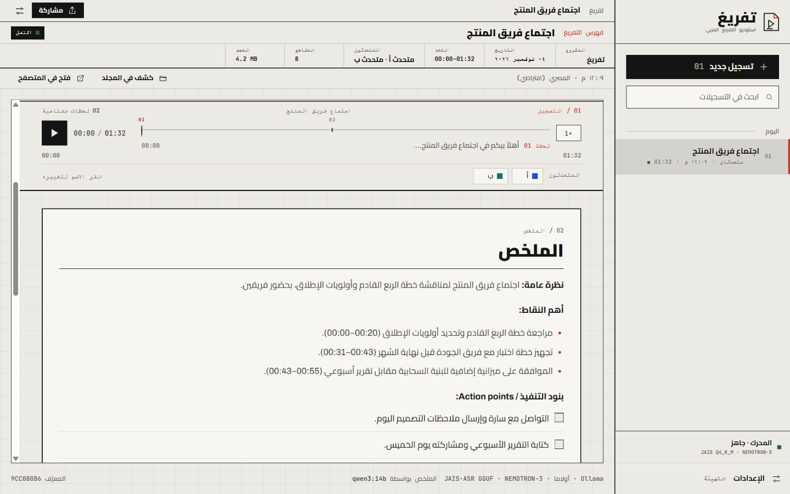
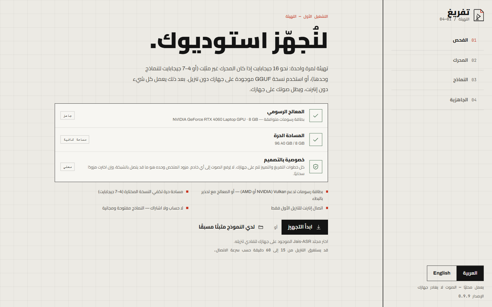
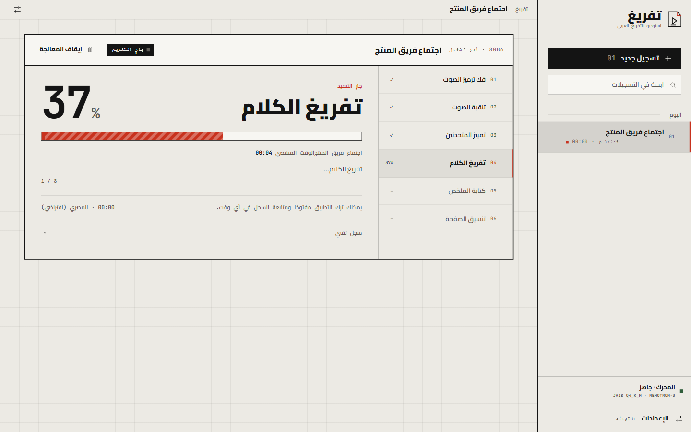
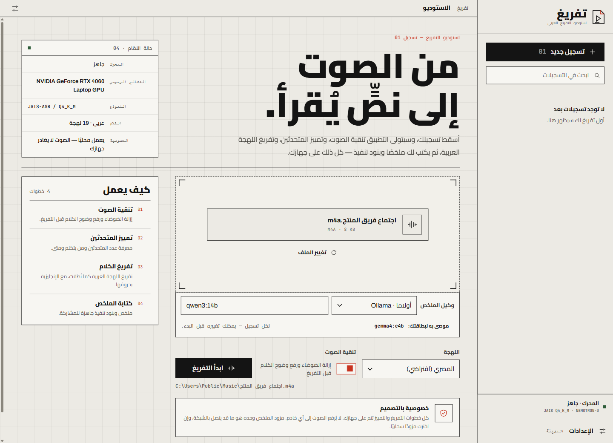
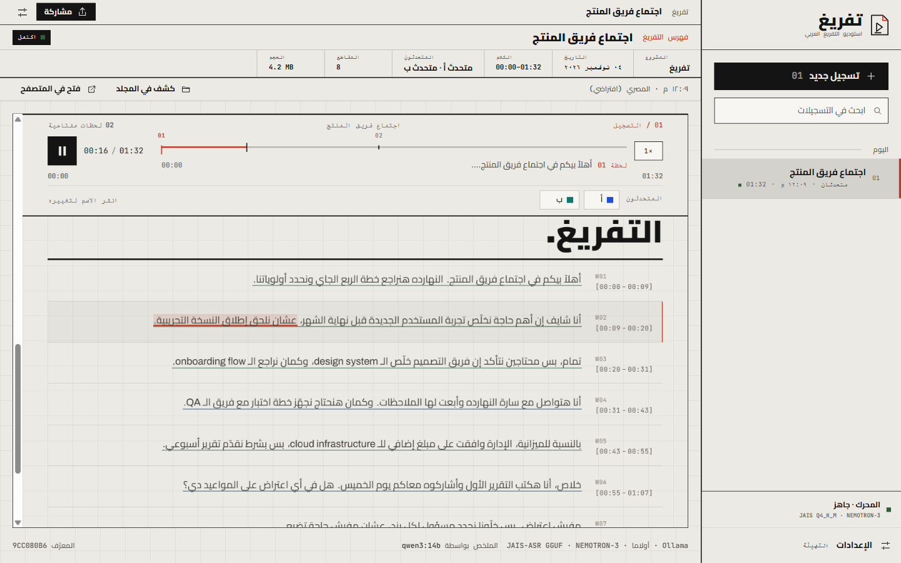
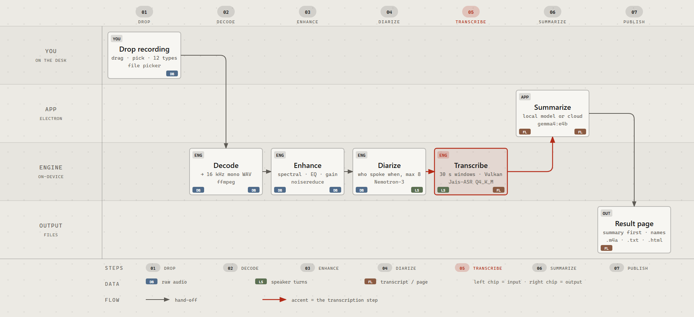

# تفريغ — Tafreegh

**English** · [العربية](README.ar.md)

Tafreegh (تفريغ) is a packaged Windows desktop app that turns Arabic recordings into a speaker-labelled transcript plus an AI summary, and publishes the result as one self-contained HTML page. It is built with Electron 45, React 19 and TypeScript, with a Python 3.12 worker for the audio pipeline. It is not a web app: there is no Docker, no localhost server and no browser step, because the result is shown in a sandboxed iframe inside the app. Installers are an MSI and an NSIS EXE for x64, version 0.9.10. They are unsigned, so Windows SmartScreen warns on first launch.

## Accuracy and use

> **Tafreegh is an assistance tool, not a record of evidence.**

Transcription and speaker labels are produced automatically by a speech model, so they will contain errors: misheard or dropped words, sentences attributed to the wrong speaker, approximate timestamps, and a summary that can leave out or misstate what was said. Treat the output as a first draft that helps you navigate a recording, not as a verbatim or certified transcript.

Do not rely on it as a legally binding record, as evidence in legal, disciplinary, employment or official proceedings, or as a substitute for professional advice. In those settings, check every passage against the original audio and have a qualified person review the result.

The software is provided "as is", without warranty of any kind. You are responsible for how you use the output.

## 100% local by default

The whole audio path runs on your machine. Decoding, enhancement, diarization and transcription are executed locally, and the recording is never uploaded. There is no account, no sign-in, no telemetry and no usage reporting. After the first-run download the app works fully offline.

There is exactly one exception, and it is optional: the summariser. If you pick a cloud provider, only the transcript text is sent, never the audio and never the file. Pick a local endpoint (Ollama, LM Studio, llama.cpp, vLLM, or any OpenAI-compatible server) or choose "no summary" and everything stays on the device. The default is local: Ollama on the same machine.

## Screenshots



| Setup | Processing |
|---|---|
|  |  |





All screenshots are mock-mode captures (`TAFREEGH_MOCK=1`) with invented names and recordings. No real recording is in this repository.

## Workflow



The diagram is generated from `docs/diagram-workflow.html`, which is a single self-contained file.

| # | Step | What happens |
|---|---|---|
| 1 | Drop and decode | Drag a file in or pick one; ffmpeg decodes it to 16 kHz mono WAV |
| 2 | Enhance | Spectral gating, speech-band EQ, compressor and makeup gain, written back as `.m4a` |
| 3 | Diarize | Nemotron-3 separates the speakers on the CPU, up to 8 of them |
| 4 | Transcribe | Jais-ASR reads 30 s speech windows on bundled llama.cpp |
| 5 | Summarise | A local or cloud provider writes the overview, key points and action items |
| 6 | Render the page | One HTML file with the audio embedded and the summary above the transcript |
| 7 | Share | Three downloads only: enhanced `.m4a`, `.txt`, full `.html` |

## Features

### Interface

- Arabic-first RTL interface with an English toggle.
- "Drafting sheet" design: warm paper, a visible grid, Cairo and Archivo, on a 40px grid.

### Input

- Drag and drop, or a file picker.
- Accepts M4A, MP3, WAV, OGG, OPUS, MP4, AAC, FLAC, WMA, WEBM, MOV and MKV.
- 19 Arabic dialects with Egyptian as the default, plus auto-detect, MSA, mixed Arabic and English, English and French.

### Audio enhancement

- Spectral gating with `noisereduce`, a speech-band EQ, a compressor and makeup gain.
- Non-neural and dependency-light: no PyTorch in the audio path.
- The enhanced `.m4a` is one of the three exports.

### Diarization

- NVIDIA Nemotron-3-Diarization, up to 8 speakers.
- Runs on the CPU.

### Transcription

- Jais-ASR GGUF on bundled llama.cpp.
- 30 s speech windows.
- Foreign words stay in Latin script instead of being transliterated into Arabic.

### Speakers

- The speaker strip is pinned under the player. Click a chip, type a name, press Enter to save or Esc to cancel.
- Eight high-contrast colours.
- Names are written into `meta.json` and into `transcript.html` itself, so they survive a summary re-run, an export and "open in browser".
- Long names truncate with the full value on hover, and the strip wraps instead of overflowing.
- The strip is keyboard accessible.

### Summary

- Local Ollama is the default, with `gemma4:e4b`. The app starts `ollama serve` if needed, pulls the model with download progress, uses an 8192-token context and unloads the model when it is done.
- Also supported locally: LM Studio, llama.cpp, vLLM, and any OpenAI-compatible endpoint.
- Cloud providers: OpenAI, Anthropic, Google Gemini, Groq, Mistral, DeepSeek, Qwen, Moonshot (Kimi), Zhipu (GLM), OpenRouter, xAI, Together, Fireworks and Ollama Cloud.
- "No summary" is a first-class option, and a failed or skipped summary can be retried later without re-running the audio.

### Result

- One self-contained HTML file with the audio embedded.
- The summary card comes before the transcript, the transcript is click-to-seek, and a key-moments rail sits alongside.
- Exactly three downloads: the enhanced `.m4a`, the `.txt` and the full `.html`.

### History, progress, setup

- History sidebar with search, grouped into today, yesterday, this week and older, plus delete for a recording and its files.
- Progress screen: stage list, percentage, clip counter, elapsed clock, technical log and cancel.
- Setup wizard: GPU and disk check, then the runtime (uv, Python 3.12 and the dependencies), then models, then ready. Downloads resume if interrupted, you can point the app at model folders you already have, and you can switch the artifact.
- API keys are encrypted with the OS `safeStorage`. No telemetry.

## Models and published benchmarks

The numbers below are the publishers' own measurements. Tafreegh did not benchmark them.

### Transcription: Jais-ASR (IFM / MBZUAI)

Source: [IFM/Jais-ASR-GGUF](https://huggingface.co/IFM/Jais-ASR-GGUF). Scores are WER and CER percentages, macro-averaged over the six test sets of the Open Universal Arabic ASR Leaderboard (SADA, Common Voice 18, MASC clean, MASC noisy, MGB-2, Casablanca), with greedy decoding. Lower is better.

| Artifact | Download | WER % | CER % | Peak GPU |
|---|---|---|---|---|
| BF16 reference (not shipped) | 11.44 GB | 22.85 | 8.37 | 12.42 GiB |
| Q4_K_M + mmproj Q6_K (default, <9 GB VRAM) | 3.71 GB | 22.99 | 8.38 | 5.03 GiB |
| Q8_0 + mmproj F16 (9-12.5 GB VRAM) | 6.71 GB | 22.83 | 8.35 | 7.55 GiB |

On that leaderboard the BF16 model leads the open-weight field and the commercial Speechmatics Melia 1 (23.51) and ElevenLabs Scribe v2 (24.54) APIs on average WER, and the 8-bit build matches BF16 accuracy while using about 39% less GPU memory.

### Diarization: NVIDIA Nemotron-3-Diarization

Source: [nvidia/Nemotron-3-Diarization](https://huggingface.co/nvidia/Nemotron-3-Diarization). 100M parameters, up to 8 speakers. Diarization Error Rate (DER) in percent, lower is better, at the 30.4 s offline configuration with a 0 s collar, except CALLHOME at 0.25 s.

| Corpus | DER % |
|---|---|
| DIHARD III (full, 1-9 speakers) | 12.73 |
| CALLHOME-Part2 (full) | 9.10 |
| AMI Test SDM (far-field) | 11.14 |
| NOTSOFAR1 Eval SC (far-field) | 11.00 |

At the same 30.4 s setting it cuts DER from 19.09 to 12.73 on DIHARD III versus NVIDIA's previous 4-speaker streaming model, and speaker-count accuracy on DIHARD III is 81.47%. Tafreegh runs diarization on the CPU through nemo-speech, so wall-clock speed differs from the GPU real-time factor in the model card; the DER figures are model-level.

## Install

Download the latest release from [releases/latest](../../releases/latest).

| File | Size | SHA-256 |
|---|---|---|
| `Tafreegh-0.9.10-setup-x64.exe` | 124,094,729 B | `76450BC68DB34B7B33322E0CA90A988E8FE16DAF3C7FF105BE382A44C03BE209` |
| `Tafreegh-0.9.10-setup-x64.msi` | 131,481,600 B | `A268648FA05F36D5F56A7D7BC46A00FE0E192664277593C8E3DC4C5342429E75` |

The install is per-user and needs no administrator rights. The installer is unsigned: if SmartScreen shows "Windows protected your PC", choose More info, then Run anyway.

## First run, and Python

**You do not install Python.** The app handles it.

On first run the app downloads `uv`, installs a private CPython 3.12 under `%LOCALAPPDATA%\Tafreegh\runtime\uv\python`, and builds its own virtual environment at `%LOCALAPPDATA%\Tafreegh\runtime\venv`. Your `PATH` is not touched, no admin rights are needed, and the interpreter is private to the app.

If a system interpreter already exists, setup probes it and reuses it only when it is Python 3.10 or newer and already has the worker dependencies. Otherwise it builds the managed 3.12 environment. A separate Python 3.12 is required only for development and mock mode, where it is called as `py -3.12`.

The wizard has four phases:

| Phase | What it does |
|---|---|
| 1. Check | GPU and free disk space |
| 2. Runtime | `uv`, Python 3.12, then the worker dependencies |
| 3. Models | The ASR artifact and the diarization model |
| 4. Ready | The app is usable offline |

Expect 15 to 60 minutes depending on connection speed, with a 10 to 18 GB download in total.

## Requirements

| Requirement | Detail |
|---|---|
| OS | Windows 10 or 11, x64 |
| GPU | Vulkan-capable GPU with 6 GB+ VRAM (NVIDIA or AMD); CPU fallback is very slow |
| Disk | about 13 GB with the Q4 artifact, about 16 GB with Q8 |
| Network | internet on first run only |

## Data and uninstall

| Path | Contents |
|---|---|
| `%LOCALAPPDATA%\Tafreegh\settings.json` | Interface, dialect and provider settings |
| `%LOCALAPPDATA%\Tafreegh\secrets.json` | Encrypted API keys |
| `%LOCALAPPDATA%\Tafreegh\history.json` | Recording index |
| `%LOCALAPPDATA%\Tafreegh\setup.json` | First-run completion flag |
| `%LOCALAPPDATA%\Tafreegh\jobs\<id>\` | Enhanced audio, HTML, TXT, JSON, summary and log for one recording |
| `%LOCALAPPDATA%\Tafreegh\runtime\` | `uv` and the isolated Python environment |
| `%LOCALAPPDATA%\Tafreegh\models\jais-asr\` | Jais-ASR weights |
| `%LOCALAPPDATA%\Tafreegh\models\nemo-diarization\` | Diarization weights |
| `%LOCALAPPDATA%\Tafreegh\bin\nemo-speech\` | The nemo-speech runtime |

Set `TAFREEGH_DATA_DIR` to move the data root somewhere else. Uninstall deletes everything under it, except during an upgrade, where the models are kept.

## Privacy

- The recording stays on the machine. Audio is never uploaded, and the local pipeline does not need a network connection.
- No account, no sign-in, no telemetry, no analytics, no crash reporting.
- A cloud summariser receives only the transcript text: speaker labels, timestamps, and a title derived from the file name. Never the audio, never the file.
- API keys are encrypted at rest with the OS `safeStorage`.
- No credential is bundled with the app: the source tree and both installers were scanned before release, see [docs/SECURITY-AUDIT.md](docs/SECURITY-AUDIT.md).

Full detail is in [docs/PRIVACY.md](docs/PRIVACY.md).

## Known limits

- The installer is unsigned, so SmartScreen shows a warning until you choose More info, then Run anyway.
- Highlight timing inside a 30 s window is proportional to character count, so it can drift by a few seconds within that window.
- The 4-bit model wants a Vulkan-capable GPU. Without one it falls back to the CPU with a warning and is very slow.
- One job runs at a time; the rest queue.
- A summary failure leaves the transcript intact, with an error message and a retry button.

## Development

```powershell
npm install
npm run dev
$env:TAFREEGH_MOCK = "1"
npm run dev
npm test
npm run typecheck
npm run build
npm run dist:msi
npm run dist:nsis
```

Tests: the backend uses pytest, the renderer and main process use Vitest, and end-to-end flows use Playwright. Build and signing details are in [docs/BUILDING.md](docs/BUILDING.md), and the internal design is in [docs/ARCHITECTURE.md](docs/ARCHITECTURE.md).

## License

GNU AGPL-3.0, copyright (C) 2026 Yossef Ismail. See [LICENSE](LICENSE).

The bundled models keep their own licences, and Tafreegh does not redistribute them: Jais-ASR is Apache 2.0 ([model card](https://huggingface.co/IFM/Jais-ASR-GGUF)) and Nemotron-3 Diarization is OpenMDW 1.1 ([model card](https://huggingface.co/nvidia/Nemotron-3-Diarization)). The fonts and llama.cpp are covered in [THIRD-PARTY-NOTICES.md](THIRD-PARTY-NOTICES.md), and the licence files ship inside the installed app under `resources/`.
